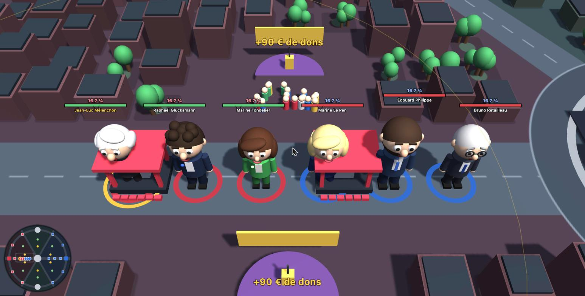
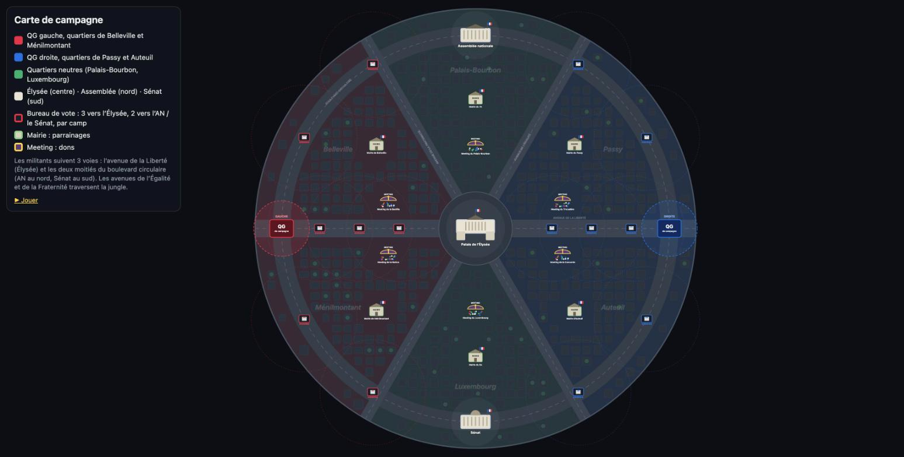
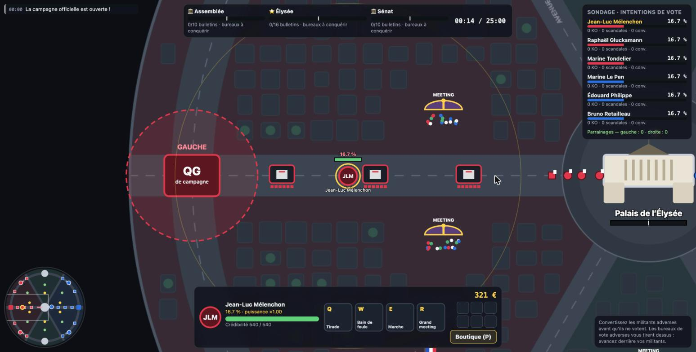

# Campagne 2027

MOBA satirique en 3 contre 3 : gauche contre droite, avec des candidats à l’élection présidentielle 2027. Le but n’est pas de détruire le QG adverse mais de **conquérir l’Élysée** au centre de la carte. Le candidat du camp gagnant qui est le mieux placé dans les sondages est élu président de la République.

Ce jeu web en 3D (Three.js r128, chargé depuis cdnjs) tient en un seul dossier, sans build. Les candidats y sont des caricatures à grosse tête, construites en volumes simples, sans aucune photo.



## Lancer le jeu

Ouvrez `index.html` dans un navigateur. Pour voir la carte seule avec sa légende, ouvrez `map.html`. Pour passer par un serveur local :

```bash
python3 -m http.server 8127 --directory .
```

puis ouvrez http://localhost:8127.

Le menu propose trois modes :

1. **Solo** : seul avec et contre des bots. Vous choisissez votre camp, puis un candidat de ce camp ou un neutre. Fonctionne sans serveur, même en ouvrant `index.html` directement.
2. **En ligne · 3 joueurs contre les bots** : les 3 joueurs sont dans le même camp. On crée une **salle** dont on partage le **code** (l’hôte choisit le camp et la durée), ou on passe par le **matchmaking**.
3. **En ligne · 3 contre 3** : matchmaking à 6 joueurs.

En matchmaking, on ne choisit **pas** son camp : le serveur l’attribue. Chacun choisit ensuite un candidat de son camp ou un neutre, sans doublon, avec **1 tank, 1 DPS et 1 soutien par équipe** (les classes déjà prises par les coéquipiers sont grisées). Les bots complètent les équipes. Sans choix à la fin du compte à rebours (45 s), le serveur attribue un candidat.

## Jeu en ligne

Les modes en ligne ont besoin du serveur Node fourni (`server/`, Node 18 ou plus) :

```bash
npm install
npm start
```

puis ouvrez http://localhost:8080 dans plusieurs onglets ou sur plusieurs machines du réseau local (avec l’adresse IP de la machine). Le même serveur sert les fichiers du jeu et le WebSocket (`/ws`).

- Le serveur est **autoritaire** : chaque salle fait tourner sa propre copie du moteur (`src/data.js`, `map.js`, `game.js`, `ai.js`, chargés dans un contexte `vm` isolé) à 60 Hz. Il envoie l’état environ 20 fois par seconde ; le navigateur interpole ces instantanés pour un rendu fluide.
- Les navigateurs n’envoient que des **intentions** : direction au clavier, clic (déplacement ou cible), sort (visée automatique, ou point visé avec Maj), récolte (Entrée), cible (Tab), retour au QG (B), achat.
- Chaque joueur humain a l’attaque automatique en mouvement et la visée automatique. La difficulté ne s’applique qu’aux bots adverses du solo.
- Si un joueur quitte la partie (Échap, puis « Quitter la partie ») ou perd la connexion, un bot reprend son candidat.

Variables d’environnement : `PORT` (8080 par défaut), `PICK_TIME` (durée de la sélection, 45 s), `MM_COOP_WAIT` (20 s : passé ce délai, une partie coop démarre avec les joueurs présents) et `MM_PVP_WAIT` (60 s : passé ce délai, un 3 contre 3 démarre s’il y a au moins 2 joueurs, en camps équilibrés complétés par des bots).

Si la page du jeu est servie ailleurs que par le serveur (par exemple sur GitHub Pages), indiquez l’adresse du serveur dans le champ **Serveur** du menu en ligne (`wss://mon-serveur.example`) ou dans `window.MOBA_SERVER` en bas de `index.html`.

### Hébergement

Un hébergement **statique** comme GitHub Pages suffit pour le solo, mais **pas** pour le jeu en ligne : il faut un processus Node qui reste allumé et accepte les WebSockets. Options possibles :

- **Render**, **Railway** ou **Fly.io** : déploiement direct du dépôt (`npm install`, puis `npm start`, port fourni par la variable `PORT`). Les offres gratuites mettent souvent le serveur en veille quand personne ne joue, d’où une première connexion lente.
- **Un petit VPS** (Scaleway, OVH, Hetzner…) : `npm start` derrière un proxy HTTPS (Caddy ou nginx) qui transmet aussi les WebSockets, pour pouvoir utiliser `wss://`.
- **Mixte** : le jeu sur GitHub Pages et le serveur sur l’une des options ci-dessus, en renseignant l’adresse `wss://` du serveur.

Rien n’est déployé publiquement pour l’instant.

## La carte



- La ville est un **cercle** coupé en **6 quartiers** par 3 avenues (Liberté, Égalité, Fraternité). Un boulevard circulaire en fait le tour.
- Les **QG de campagne** sont à l’ouest (gauche) et à l’est (droite).
- Il y a **3 voies de militants**, comme dans un MOBA classique :
  - **Avenue de la Liberté** (voie centrale) : QG, puis 3 bureaux de vote, puis l’**Élysée**.
  - **Boulevard nord** : QG, puis 2 bureaux de vote, puis l’**Assemblée nationale**.
  - **Boulevard sud** : QG, puis 2 bureaux de vote, puis le **Sénat**.
- La **jungle** (les quartiers) contient une **mairie** et un **meeting** par quartier. Les quartiers du nord et du sud sont neutres.



## Règles

| Mécanique | Fonctionnement |
|---|---|
| **Militants** | Une vague par voie toutes les 22 s. Chaque militant porte un bulletin. Les vagues grossissent au fil de la partie. |
| **Bureaux de vote** | 6 bulletins adverses suffisent à conquérir un bureau. Un bureau conquis peut être **repris** par les militants de son camp d’origine (il repart alors avec 3 bulletins). Les militants doivent reprendre chaque bureau perdu sur leur chemin avant d’aller au suivant. Un bureau tire sur les candidats adverses, jamais sur les militants. |
| **Objectifs** | Une voie s’ouvre quand tous les bureaux adverses de cette voie sont conquis. Les militants votent alors à l’objectif. Chaque objectif a une jauge commune à remplir, et les deux camps peuvent voter dans la même jauge, chacun la tirant vers soi. |
| **Assemblée nationale** | 10 bulletins donnent la majorité, qui renforce les militants du camp de 25 %. |
| **Sénat** | 10 bulletins donnent la majorité, qui rapporte des parrainages et des dons en continu. |
| **Élysée** | 16 bulletins font gagner la présidentielle. |
| **Second tour** | À 60 % du temps, chaque bulletin compte double. |
| **Conversion** | Un candidat qui met KO un militant adverse le « convertit » : le militant rentre chez lui sans voter, et le candidat gagne des dons et des points de sondage. |
| **Polémiques** | Les attaques des candidats sont des polémiques, lancées sous forme de **phylactères** (« Honte ! », « Démission ! »…). Les sorts sont des bulles pleines aux couleurs du camp. Chaque coup fait baisser la cible dans les sondages au profit de l’attaquant. À 0 de crédibilité, c’est le scandale : 15 % de son score perdu et retour au QG. Le délai de retour vaut 1 s par point de sondage (de 3 à 15 s), et toutes les recharges sont remises à zéro. |
| **Sondage** | Tout le monde part de **0 %** : les 100 % sont d’abord des **indécis**. Conversions, bulletins, bureaux conquis et mairies font gagner des indécis, de plus en plus difficilement à mesure qu’il en reste peu. Polémiques et scandales font passer des points d’un candidat à l’autre. Le score détermine la **puissance** (dégâts et crédibilité). |
| **Sorts** | Ils se débloquent dans les sondages : **A à 5 %**, **Z à 10 %**, **E à 15 %**, **R à 30 %**. Un sort débloqué le reste. |
| **Mairies** | Rapportent des **parrainages** (et du sondage). Plus votre camp a vidé une mairie, plus elle rapporte. |
| **Meetings** | Rapportent des **dons**. Chaque meeting déjà organisé par votre camp dure 2 s de plus mais rapporte 70 € de plus. |
| **Récolte** | Il faut rester **immobile** : 12 s de son côté de la carte, 7 s du côté adverse, 10 s dans les quartiers neutres. Bouger annule la récolte, qui repart de zéro. |
| **Programme** | Au QG (P, puis flèches et Entrée, ou 1 à 9), on adopte des **mesures** qui ne se consomment pas : chacune **s’améliore jusqu’au niveau 5**, de plus en plus chère et puissante. Leurs noms dépendent du camp : sociales, écologiques et anti-libérales à gauche (Taxe sur les superprofits, Hôpital public, Planification écologique…), sécuritaires, régaliennes et budgétaires à droite (Peines planchers, Remboursement de la dette, Dissuasion nucléaire…). Catégories : polémique (DPS), résistance (tank), sorts, recharge, vitesse et **finances** (plus de dons par seconde, ou réduction sur tous les achats). 6 mesures au maximum. |
| **Matériel de campagne** | T-shirts (+PV), casquettes (+vitesse), banderoles (+dégâts), flyers (+1 militant par vague), affiches (bulletins qui rapportent plus de sondage). Il renforce tous les militants du camp, 3 niveaux de plus en plus chers. |
| **Victoire** | Il faut gagner la **présidentielle** (Élysée) **et** avoir la majorité dans **au moins une chambre** (Assemblée ou Sénat). Sinon c’est la cohabitation, et la partie continue. |
| **Durée** | 5, 10 ou 15 minutes, au choix dans le menu. À la fin du temps, le candidat **en tête des sondages** l’emporte pour son camp et il est élu. |

## Candidats

Les 33 personnalités suivies par [Poligraph](https://poligraph.fr/elections/presidentielle-2027/candidats) (candidatures annoncées ou pressenties) sont jouables. Elles sont classées à gauche, à droite, ou parmi les **neutres et inclassables**. Ces derniers sont un peu plus faibles (−12 % de crédibilité et de dégâts) mais jouables dans les deux camps.

Chaque équipe compte **un tank** (voie de l’Assemblée), **un DPS** (avenue de l’Élysée) et **un soutien** (voie du Sénat). Les bots complètent l’équipe du joueur et l’équipe adverse.

| Classe | Archétypes (inspirés des MOBA) |
|---|---|
| **Tank** | Bastion (étourdissements), Colosse (récupère 75 % en 10 s), Rempart (boucliers de zone, affaiblissement) |
| **DPS** | Mage (zone et brûlures), Tireur (projectiles, tir à travers la carte), Assassin (bond, soin sur soi, frappe et brûlure), Artilleur (très longue portée), Duelliste (corps à corps, régénération) |
| **Soutien** | Soigneur (soin de zone, soin global), Protecteur (boucliers d’équipe), Enchanteur (soins, accélération, affaiblissement) |

Les mécaniques de sorts disponibles :
- bonds, avec ou sans dégâts ou étourdissement ;
- projectiles, éventuellement perforants ;
- zones de dégâts, immédiates, différées ou persistantes ;
- soins : de zone, globaux, sur soi, ou sur la durée ;
- boucliers : sur soi ou de zone ;
- affaiblissements (−dégâts et −vitesse), brûlures, ralentissements, étourdissements, accélérations.

Chaque candidat a des noms de sorts qui lui sont propres. Les 6 premiers ont des kits sur mesure.

| Gauche | Droite | Neutres |
|---|---|---|
| Nathalie Arthaud, Delphine Batho, Karim Bouamrane, Bernard Cazeneuve, Raphaël Glucksmann, Anasse Kazib, Selma Labib, Jean-Luc Mélenchon, Fabien Roussel, François Ruffin, Marine Tondelier | Gabriel Attal, Olivier Becht, Xavier Bertrand, Nicolas Dupont-Aignan, Marine Le Pen, David Lisnard, Édouard Philippe, Florian Philippot, Gilles Platret, Bruno Retailleau, Dominique de Villepin, Éric Zemmour | François Asselineau, Juan Branco, Joël Chevé, Emmanuel Dubuisson, Clara Egger, Mira Markovic, Antoine Mikolajczak, Natacha Polony, Teddy Riner, Fabien Verdier |

## Contrôles

Le jeu se joue entièrement au clavier ; la souris est facultative. Le menu propose deux modes de contrôle et trois niveaux de difficulté (Facile par défaut). La difficulté n'affecte que les candidats adverses contrôlés par l'IA : leurs dégâts, leur réactivité et la fréquence de leurs sorts.

| Action | Mode « Flèches » (par défaut) | Mode « ZQSD » |
|---|---|---|
| Se déplacer | flèches (ou clic) | ZQSD (WASD en QWERTY) ou flèches |
| Sorts | A Z E R en AZERTY (Q W E R en QWERTY) | 1 2 3 4 |

- **Attaques automatiques** : elles partent toutes seules, même en marchant, sur l'ennemi dans votre cercle de portée (jaune) : militants d'abord, puis candidats.
- **Sorts à visée automatique** : ils visent la cible verrouillée, sinon le candidat adverse le plus proche, sinon un militant. Le déplacement éclair part dans la direction des flèches enfoncées. **Maj + sort** vise à la souris.
- **Tab** : verrouiller le candidat adverse le plus proche (prioritaire pour les attaques et les sorts). **X** : libérer la cible.
- **Entrée** : récolter la mairie ou le meeting le plus proche.
- **B** : retour au QG. **P** : boutique, puis **1** à **9** pour acheter.
- **Espace** : caméra libre. **Molette** : zoom. **Échap** : pause en solo ; en ligne, menu pour quitter (la partie continue).

Quand votre candidat est mis KO par un scandale, un grand compte à rebours s'affiche au centre de l'écran jusqu'à son retour. Le délai de retour de chaque candidat apparaît aussi dans le sondage.

## Structure

```
index.html      jeu (HUD + styles)
map.html        carte seule avec légende
src/data.js     réglages, candidats, objets
src/map.js      géométrie de la carte (voies, bureaux, objectifs, camps)
src/game.js     moteur de règles
src/ai.js       IA des candidats non joueurs
src/render.js   rendu 2D (texture du sol, carte de map.html, mini-carte)
src/render3d.js rendu 3D : ville, bâtiments, candidats caricaturés, militants
src/ui.js       menu, HUD, contrôles souris / clavier, surcouche, boucle de jeu
src/net.js      client en ligne : connexion, miroir de l’état, interpolation des instantanés
server/server.js serveur en ligne : salles, codes, matchmaking, sélection, moteur à 60 Hz
```

Tous les équilibrages se règlent dans `CFG` (`src/data.js`).

## Crédits des assets

- Immeubles : [City Kit (Commercial)](https://kenney.nl/assets/city-kit-commercial) de **Kenney**, sous licence CC0 (voir `assets/kenney/city-commercial/License.txt`). Les modèles sont chargés avec `GLTFLoader` (three@0.128.0, jsdelivr) et teintés selon le quartier. Si les modèles ne se chargent pas, par exemple quand le jeu est ouvert en `file://`, les blocs simples restent affichés. Paramètres d'URL : `?blocs=1` force la ville simplifiée, et `?ombres=1` active les ombres des immeubles (plus coûteuses).
- Mairies : *Town House*, *Big Building* et *Building* de **Quaternius** (CC0, via [Poly Pizza](https://poly.pizza)), dans `assets/quaternius/`.
- Scènes de meeting : *Stage* et *Concert Stage* (×2) de **iPoly3D** (CC0, via Poly Pizza), recolorées en violet, dans `assets/ipoly3d/`.
- La campagne qui entoure la ville (champs, fermes, bottes de foin, haies, vaches) et Marine Le Pen en style voxel (essai) sont construites en code.
